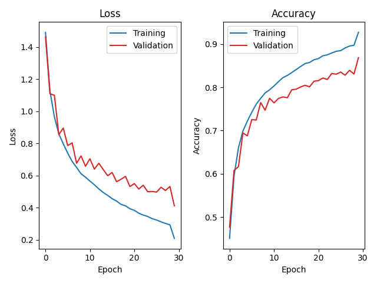

# Lab 1 Homework Template

### 1. Model Architecture (15%)

Briefly explain how you built your model and why.

My model just like the model discribe in the homework guidline, which contains five 2D convolution layers, three 2x2 max poolings, and three linear layers. The only difference is that I add batch normalization layer after each convolution layer.

### 2. Loss/Epoch and Accuract/Epoch Plotting (15%)

Plot the training/validation loss curve of your best model and determine whether overfitting is occurring.

- Loss/Epoch plot of training and validation
- Accuracy/Epoch plot of training and validation



### 3. Accuracy Tuning (20%)

- Explain what data preprocessing techniques you used if existed to imporve your accuracy.
1. Random cropping (32, padding=4)
2. Random horizontal flipping
3. Random rotation (15 degrees)
Apply these data augmentation to increase training data, reduce overfitting and promote generalization.
4. Normalization : standardize input images.
Normalize input data can converge quicker.

- List your hyperparameters and explain why they are set this way to imporve your accuracy.

| Hyperparameter | Loss function | Optimizer | Learning Rate | Scheduler | Weight decay or Momentum | Epoch | Accuracy |
| -------------- | ------------- | --------- | ------------- | --------- | ------------------------ | ----- | -------- |
| Best model          | CrossEntropyLoss | SGD | 0.01 | ReduceLROnPlateau (patience=2) | weight decay=1e-4 momentum=0.9 | 30 | 0.89 |
- (**Bonus: +10% of this report**) Perform a comprehensive comparison of different hyperparameters through an ablation study to assess their individual impact on model performance and understand how each hyperparameter contributes to the overall results. 

| Hyperparameter | Loss function | Optimizer | Learning Rate | Scheduler | Weight decay or Momentum | Epoch | Accuracy |
| -------------- | ------------- | --------- | ------------- | --------- | ------------------------ | ----- | -------- |
| Best model | CrossEntropyLoss | SGD | 0.01 | ReduceLROnPlateau (patience=2) | weight decay=1e-4 momentum=0.9 | 30 | 0.89 |
| Use Adam optimizer | CrossEntropyLoss | Adam | 0.01 | ReduceLROnPlateau (patience=2) | | 30 | 0.866
| Add smoothing to loss function | CrossEntropyLoss (label_smoothing=0.1) | SGD | 0.01 | ReduceLROnPlateau (patience=2) | weight decay=1e-4 momentum=0.9 | 30 | 0.869
| Start training from lr=0.1 | CrossEntropyLoss | SGD | 0.1 | ReduceLROnPlateau (patience=2) | weight decay=1e-4 momentum=0.9 | 30 | 0.875 |
| Use cosine anealling scheduler | CrossEntropyLoss | SGD | 0.01 | CosineAnnealingLR (T_max=epochs, eta_min=1e-6) | weight decay=1e-4 momentum=0.9 | 30 | 0.886 |

### 4. Explain how the Power-of-Two Observer in your QConfig is implemented. (25%)

1. Explain how to caluclate ***scale*** and ***zero-point***.
* scale
$$
s = \frac{2max(|\alpha|, |\beta|)}{q_{max} - q_{min}} \in \mathbb{R} , \text{where } \alpha = \text{min_val, } \beta = \text{max_val}
$$
$$
z = \left\lceil {\frac{q_{max}-q_{min}}{2}} \right\rceil = 
\begin{cases}
0 \text{, if signed} \\
128 \text{, if unsigned}
\end{cases}
$$

To calculate scale, we have to run evaluation one time to observe $\alpha$ and $\beta$. Since we want to quant to 8 bits, $q_{max}$ and $q_{min}$ equals to 127 and -127 if signed, 256 and 0 if unsigned.

2. Explain how ```scale_approximate()``` function in ```class PowerOfTwoObserver()``` is implemented.
We want to quantize weight to the nearest order of 2 with following steps.
i.  Taking the logarithm of weight(FP32) with base 2, weight = $2^{exp}$
`exp = math.log2(scale)`
ii. Set the maximum value of the exponent to 0 to avoid the case where weight=0
`max(-exp, 0)`
iii. Set the minimum value of the exponent to `max_shift_amount = 8`，ensuring that any weight < $2^{-8}$ is quantized to $2^{-8}$
`min(max(-exp, 0), max_shift_amount)`
iv. Round the exponent to the nearest integer after applying the constraints
`exp_q = round(min(max(-exp, 0), max_shift_amount))`
```
def scale_approximate(self, scale: float, max_shift_amount=8) -> float:
        exp = math.log2(scale)
        exp_q = round(min(max(-exp, 0), max_shift_amount));
        
        return 2 ** -exp_q 
```
3. When writing ```scale_approximate()```, is there a possibility of overflow? If so, how can it be handled?
Yes, there is a possibility of overflow if scale is either too big or too small(close to 0), which makes $-log_2(scale)$ become negative or $-\infty$ .
To prevent overflow, use min() and max() to clamp scale into appropriate range.

### 5. Comparison of Quantization Schemes (25%)

Given a **linear layer (128 → 10)** with an input shape of 1×128 and an output shape of 1×10, along with the energy costs for different data types, we will use the provided table to estimate the total energy consumption for executing such a fully connected layer during inference under the following two scenarios:

1. Full precision (FP32)
2. 8-bit integer, power-of-2, static, uniform symmetric quantization
    - activation: UINT8
    - weight: INT8


| Operation                        | Energy consumption (pJ)    |
| -------------------------------- | -------------------------- |
| FP32 Multiply                    | 3.7                        |
| FP32 Add                         | 0.9                        |
| INT32 Add                        | 0.1                        |
| INT8 / UINT8 Multiply            | 0.2                        |
| INT8 / UINT8 Add                 | 0.03                       |
| Bit Shift                        | 0.01                       |


#### Hint

- The energy consumption of INT32 addition should also be considered. Each INT32 addition consumes 0.1 pJ of energy, as depicted in the figure of the lab hanout.
- Since we are using **static quantization** in this lab, the power-of-two scaling factors for input, weight, and output can fused into **ONE** integer before the inference.
- The summation is computed under **INT32** rather than INT16.

You can ignore the energy consumption of type casting, memory movement, and other operations not listed in the table.

You can refer to the following formula previously-mentioned in the lab handout:

$$
\tag{6}
\bar y_i = \left( \text{ReLU}(\bar b_i + \sum_j (\bar x_j - 128) \cdot \bar w_{ji}) \gg \overbrace{(c_x + c_w - c_y)}^{\text{pre-computed offline}} \right) + 128
$$

Write down your **calculation process** and **answer** in detail. Answers without the process will only get partial credit.

#### Your Answer
1. Before quantization (FP32)
    according to the formula : 
    
    $$
y_i = \text{ReLU}(b_i + \sum_j x_j \cdot w_{ji})
$$

    ##### for each output y
    * 128 FP32 Multiply for $x_j \cdot w_{ji}$
    * 127 FP32 Add for $\sum_j$
    * 1 FP32 Add for $b_i +$
    
    ##### for 10 outputs 
    | Operation | Count | Energy Consumption | Total Consumption |
    | --------- | ----- | -------------- | -----|
    | FP32 Multiply | 1280 | 3.7 | 4736 |
    | FP32 Add | 1280 | 0.9 | 1152 |
    | Total Energy Consumption | | | 5888 pJ
    
    
2. After quantization
    according to the formula : 
$$
\bar y_i = \left( \text{ReLU}(\bar b_i + \sum_j (\bar x_j - 128) \cdot \bar w_{ji}) \gg \overbrace{(c_x + c_w - c_y)}^{\text{pre-computed offline}} \right) + 128
$$
    ##### for each output y
    * 128 INT8 / UINT8 Add for $(\bar x_j - 128)$
    * 128 INT8 / UINT8 Multiply for $(\bar x_j - 128) * \bar w_{ji}$
    * 127 INT32 Add for $\sum_j$
    * 1 INT32 Add for $b_i +$
    * 1 Bit Shift for $\gg$
    * 1 INT8 / UINT8 Add for $+ 128$
    
    ##### for 10 outputs 
    | Operation | Count | Energy Consumption | Total Consumption |
    | --------- | ----- | -------------- | -----|
    | INT8 / UINT8 Add | 1290 | 0.03 | 38.7 |
    | INT8 / UINT8 Multiply | 1280 | 0.2 | 256 |
    | INT32 Add | 1280 | 0.1 | 128 |
    | Bit Shift | 10 | 0.01 | 0.1 |
    | Total Energy Consumption | | | 422.8 pJ |

|                         | Before quantization (FP32) | After quantization (INT8)|
| ----------------------- | ---- | --------- |
| Energy consumption (pJ) | 5888 | 422.8     |

### 6. Homework Requirments

| Requirments | My model |
| ---------- | -------- |
| quanytized model size < 4MB | 3.35MB |
| top-1 accuracy on CIFAR-10 ≥ 80% | 89% |
| accuracy drop ≤ 1% | 0.11% (accuracy of quantized model = 88.9%)|

This lab is executed on kaggle using GPU P100, accuracy may  be different by using different GPU or CPU.