# Lab 4 Homework Template

## PASS Screenshot
### DLA (total 30%)
##### Testbench `dla0` 7.5%
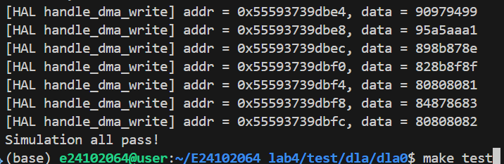

##### Testbench `dla1` 7.5%
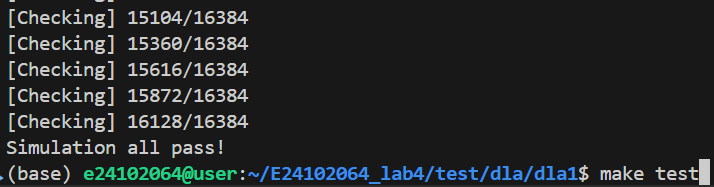

##### Testbench `dla2` 7.5%
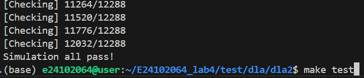

##### Testbench `dla3` 7.5%
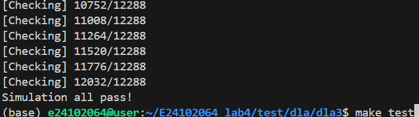

### CPU (total 60%)
Each `original version` operation contributes **7.5** points to the overall score.
Each `Improved version` operation is based on **the degree of cycle reduction**, with a full score of 7.5 points.
Please refer to the section below for detailed evaluation criteria.
##### `qconv2d_relu_maxpool_cpu`
**Original**
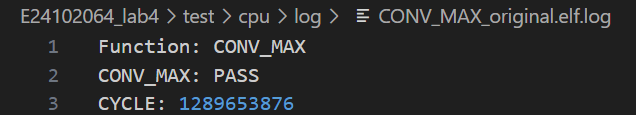

**Improve**
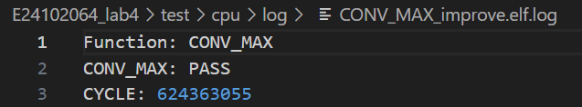

##### `qconv2d_relu_cpu`
**Original**
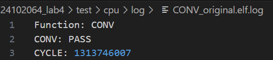
**Improve**
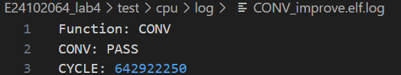

##### `qlinear_relu_cpu`
**Original**
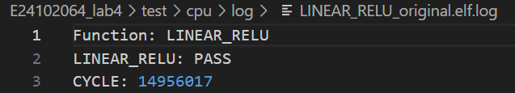

**Improve**
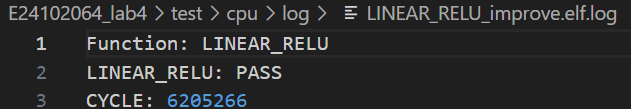

##### `qlinear_cpu`
**Original**
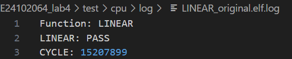

**Improve**
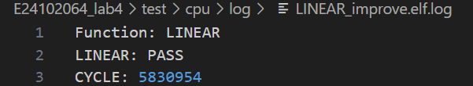

## Performance in CPU
Please fill in the number of execution cycles and the results from the Valgrind analysis.
| Function     |            D refs      |        D1 miss      |   Cycle (roughly), depend on server status  | Cycle reduction ratio |
|------------------|--------------------|---------------------|-----------|--------|
|`CONV_original`         | 2,997,178,736 | 61,044 | 1313746007 |
|`CONV_improve`          | 1,406,600,838 | 29,696 | 642922250 | 0.51 |
|`CONV_MAX_original`     | 2,997,714,859 | 56,350 | 1289653876 |
|`CONV_MAX_improve`      | 1,406,782,492 | 29,476 | 624363055 | 0.51 |
|`LINEAR_original`       | 19,005,036 | 18,487 | 15207899 |
|`LINEAR_improve`        | 10,559,596 | 19,793 | 5830954 | 0.61 |
|`LINEAR_RELU_original`  | 19,007,753 | 18,488 | 14956017 |
|`LINEAR_RELU_improve`   | 10,559,730 | 19,793 | 6205266 | 0.58 |

**Scoring Criteria for every improved operation:**

| Cycles reduced ratio  | score | Note                  |
| -------------------------------- | ----- | --------------------- |
| <20%                             | 2.5%   | Basic implement score |
| 20%                              | 3.5%   |                   |
| 30%                              | 5%   |                   |
| 40%                              | 6.5%   |                   |
| 50%                              | 7.5%   |                   |

Cycle Reduction Ratio, defined as:
$$
\frac{\text{Cycle}_{\text{original}} - \text{Cycle}_{\text{improved}}}{\text{Cycle}_{\text{original}}}
$$

:::info
**❗Additional information:**
Since the number of D refs and D1 misses does not vary with the server's state, these values will be used as a reference during grading. The cycle count, however, will be evaluated with a more lenient standard.
:::

## How to improve performance in CPU 10%
:::info
Explain your method.
:::
#### general
1. Compute index and data that will be reused several times befor the for loop.
2. Use "malloc" to create a continuous memory space.
3. Compute quantization and ReLU inside the function instead of calling `quantize` function.

#### convolution
1. Don't pad ifmap before computation, check whether index exceeds boundary while computing instead.
2. Compute in the order of m -> c -> r -> s -> h -> w, reuse filter across ifmap plane h*w, increase cache hit rate.
3. Only use accu[M * H * W] to store data, don't need extra space to store padded ifmap.

#### maxpooling
1. Unroll 2*2 area, instead of using 2 for loops to iterate 4 items.

#### linear
1. Put load bias, linear, quantize apart.
2. Quantize 1 item each time instead of quantize a row.

## Feedback bonus 10%
1. Use an accurate reference instead of inaccurate cycle count when scoring.